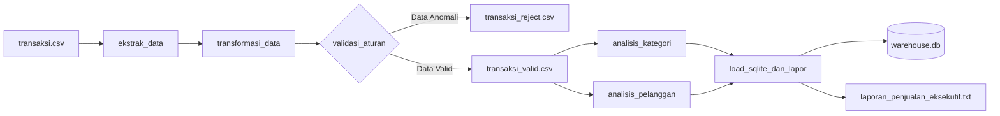
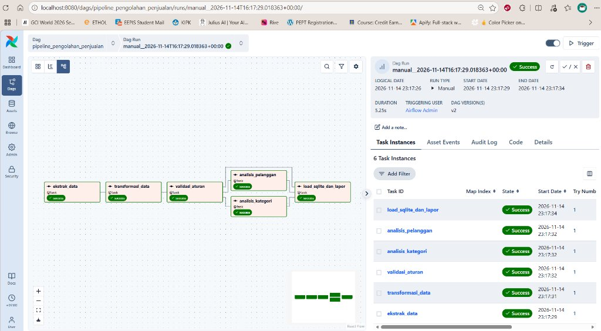
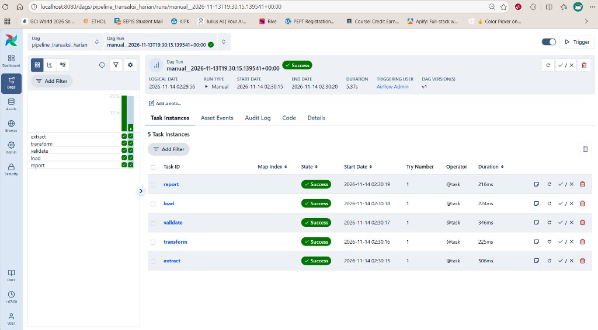
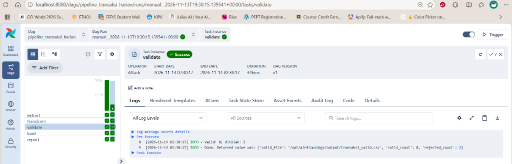
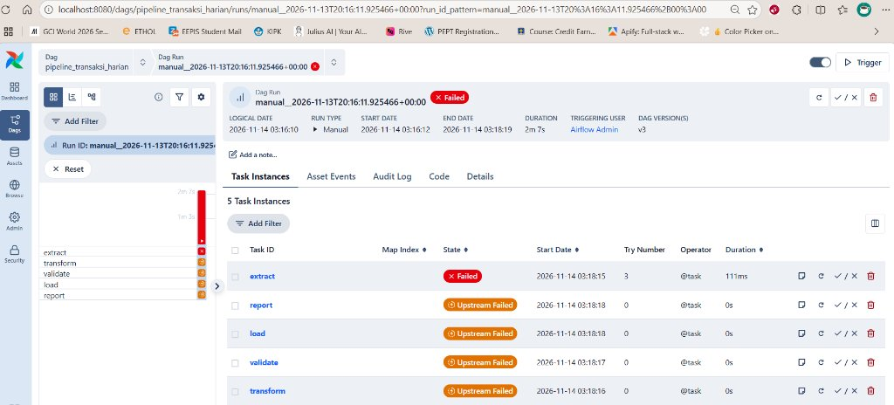

<div align="center">

# Automated Sales Data Pipeline & Orchestration
### Otomatisasi Pipeline Data Penjualan Harian dengan Apache Airflow & Docker

[](https://airflow.apache.org/)
[](https://www.docker.com/)
[](https://www.python.org/)
[](https://www.sqlite.org/)
[](LICENSE)

<p align="center">
  Pipeline data otomatis berbasis Apache Airflow dan Docker untuk mengolah transaksi penjualan harian, memvalidasi kualitas data, dan menjalankan analisis paralel.
</p>

</div>

---

## Ringkasan Proyek

Proyek ini dibangun untuk mengotomatisasi alur pemrosesan data (ETL) transaksi penjualan harian menggunakan Apache Airflow 3.4.0 di lingkungan Docker Compose. 

Tujuan utamanya adalah membangun pipeline yang andal dan mandiri:
- Membaca data transaksi mentah dari CSV.
- Membersihkan dan menstandarisasi format data.
- Memeriksa aturan validasi data (memisahkan data valid dan data anomali ke file reject).
- Menjalankan analisis ganda secara paralel (perhitungan omset per kategori dan total belanja per pelanggan).
- Menyimpan data valid ke database SQLite dan mencetak ringkasan laporan penjualan.

---

## Arsitektur Workflow

Alur kerja disusun menggunakan Airflow TaskFlow API (`@dag` dan `@task`) dengan topologi Directed Acyclic Graph (DAG) berikut:



---

## Fitur Pipeline

1. **Validasi Kualitas Data**: Menyaring data anomali seperti ID transaksi kosong, kuantitas $\le 0$, nominal negatif, dan format tanggal yang salah. Data yang tidak lolos akan dicatat ke berkas terpisah beserta alasannya.
2. **Pemrosesan Paralel**: Task `analisis_kategori` dan `analisis_pelanggan` berjalan simultan setelah tahap validasi selesai untuk mempercepat waktu pemrosesan.
3. **Toleransi Kegagalan (Retry)**: Dilengkapi konfigurasi `retries=2` dan jeda 1 menit agar pipeline dapat pulih otomatis saat terjadi kendala sementara.
4. **Penjadwalan Fleksibel**: Mendukung eksekusi terjadwal otomatis (Cron) maupun pemicuan manual langsung melalui Web UI.

---

## Tangkapan Layar & Bukti Eksekusi

<div align="center">

### Topologi DAG & Eksekusi Sukses
Alur kerja percabangan paralel pada DAG `pipeline_pengolahan_penjualan` yang berhasil dieksekusi penuh (seluruh task berstatus hijau).
<br/><br/>


<br/><br/>

### Riwayat Task Instance
Status seluruh unit pekerjaan berjalan sukses dengan waktu eksekusi yang efisien.
<br/><br/>


<br/><br/>

### Log Validasi Data
Pemeriksaan log pada task validasi yang menunjukkan data berhasil dipilah menjadi 8 record valid dan 2 record ditolak.
<br/><br/>


<br/><br/>

### Simulasi Penanganan Kegagalan (Retry)
Pengujian saat sumber data sengaja dihilangkan: task `extract` mencoba retry 2 kali, dan task di hilirnya otomatis ditandai `Upstream Failed` untuk menjaga konsistensi database.
<br/><br/>


</div>

---

## Struktur Repositori

```text
.
├── assets/
│   └── images/                       # Bukti screenshot eksekusi
├── dags/
│   ├── data/
│   │   └── transaksi.csv             # Dataset mentah transaksi
│   ├── output/
│   │   ├── ringkasan.txt             # Laporan agregasi penjualan reguler
│   │   ├── laporan_penjualan_eksekutif.txt # Laporan eksekutif tugas mandiri
│   │   ├── transaksi_valid.csv       # Sampel data lolos validasi
│   │   └── transaksi_reject.csv      # Sampel data anomali beserta alasan reject
│   ├── pipeline_transaksi.py         # DAG utama pipeline pengolahan harian
│   ├── pipeline_pengolahan_penjualan.py # DAG tugas mandiri (6 tasks + paralel)
│   ├── dag_operator_demo.py          # Demo BashOperator & EmptyOperator
│   └── dag_paralel_demo.py           # Demo alur percabangan paralel
├── .env                              # Pengaturan environment (AIRFLOW_UID)
├── .gitignore                        # Filter logs, database SQLite biner, dan cache
├── docker-compose.yaml               # Konfigurasi kluster Apache Airflow 3.4.0
├── LICENSE                           # Lisensi MIT
└── README.md                         # Dokumentasi proyek
```

---

## Panduan Menjalankan

### 1. Clone Repositori
```bash
git clone https://github.com/0raja0-RA/airflow-data-pipeline-orchestration.git
cd airflow-data-pipeline-orchestration
```

### 2. Atur Environment Variable
Sesuaikan UID host agar kontainer memiliki hak akses folder yang sama:
```bash
echo "AIRFLOW_UID=$(id -u)" > .env
```

### 3. Inisialisasi Database Airflow
```bash
docker compose up airflow-init
```

### 4. Jalankan Layanan
```bash
docker compose up -d
```

Buka browser ke `http://localhost:8080` (login default: `airflow` / `airflow`).

### 5. Menghentikan Layanan
```bash
# Menghentikan sementara
docker compose stop

# Mematikan dan menghapus kontainer
docker compose down
```

---

## Hasil Pemrosesan Data

Dari 10 baris transaksi input pada `transaksi.csv`:
- **8 Data Valid**: Berhasil disimpan ke tabel `transaksi` pada database `warehouse.db`.
- **2 Data Ditolak**: Diisolasi ke `transaksi_reject.csv` (1 ID transaksi kosong dan 1 nominal negatif).

Ringkasan laporan eksekutif yang dihasilkan:
```text
============================================================
         LAPORAN EKSEKUTIF PIPELINE DATA PENJUALAN         
============================================================
Jumlah Transaksi Valid    : 8 transaksi
Jumlah Transaksi Ditolak  : 2 transaksi
Total Omset Penjualan     : Rp5,120,000.00
Top Customer Belanja      : C003 (Total Belanja: Rp1,850,000.00)

--- RINCIAN PENJUALAN PER KATEGORI ---
• Kategori Electronics    | Qty: 1 item  | Omset: Rp 1,850,000.00
• Kategori Storage        | Qty: 1 item  | Omset: Rp   950,000.00
• Kategori Accessories    | Qty: 3 item  | Omset: Rp   865,000.00
• Kategori Audio          | Qty: 2 item  | Omset: Rp   780,000.00
• Kategori Peripherals    | Qty: 6 item  | Omset: Rp   675,000.00
============================================================
```

---

<div align="center">
  <sub>Praktikum Data Processing Workflow | Politeknik Elektronika Negeri Surabaya (PENS)</sub><br/>
  <sub>© 2026 Raja Rahman Aziiz</sub>
</div>
